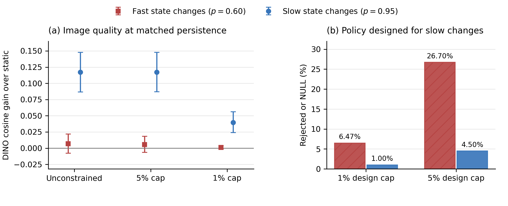

# 有限反馈该怎样用于自适应图像传输？

**目前最值得沿原 NeST 推进的问题，是在信道报告有延迟时，怎样联合选调制编码方案（MCS）和图像前缀，在提高重建质量的同时控制拒收。** 我们从一个可量化的问题出发：平均每幅图只有 1 bit 反向信息，应当频繁粗报，还是间隔精报？这几位信息的价值取决于它能改变什么。在冻结的 SwinJSCC 收发器上，反馈格式明显改变信道预测误差，改变图像质量的幅度却很小。在原 NeST 的数字帧上，同样的反馈能触发不同的保护等级和源载荷，质量收益和失效代价都更大。

2026 年 11 月 23 日完成三项工作。第一项用冻结权重实际重建图像，第二项回放公开移动网日志，第三项复用原 NeST 的真实接收结果评估新的决策表。三者的信道、时间单位和指标各有定义，数值按实验分别解读。

## 已有工作把问题推进到了哪里

| 文献 | 对本项目的启示 |
|---|---|
| SwinJSCC；DecompJSCC | SwinJSCC 已用信道状态和目标码率调节潜变量。2026 年 11 月的 DecompJSCC 预印本进一步把信噪比条件编码与编码后的内容感知码率控制拆开。单模型跨信噪比和码率工作的能力已是成熟的比较起点。[SwinJSCC](https://arxiv.org/abs/2308.09361) · [DecompJSCC](https://arxiv.org/abs/2611.18379) |
| DeepJSCC-ViT-f；CLEAR | 前者让发送端看到分块信道输出，据此继续细化同一幅图。CLEAR 在接收端利用信道冲激响应、多普勒及相噪等信息辅助重建。报告信道质量、反馈已收到的图像信息、只在接收端适配，是三种信息条件和代价都不同的系统。[DeepJSCC-ViT-f](https://arxiv.org/abs/2306.09101) · [CLEAR](https://link.springer.com/article/10.1007/s44163-026-02499-z) |
| 时间相关的 CQI 压缩；过时反馈下的中断约束速率选择 | 利用时间相关性减少信道质量指示（CQI）反馈，以及在过时反馈下约束中断概率选速率，都有直接先例。这里有研究空间的是把反馈开销、实际可装入的图像前缀、源图重建收益和数字帧拒收放在同一次决策里。[CQI 压缩研究](https://www.mdpi.com/2079-9292/8/3/278) · [Kang 等的中断约束速率选择](https://wireless.skku.edu/english/UserFiles/File/06857416%281%29.pdf) |
| 过时 CSI 下的预测式语义传输 | 2026 年的这项研究已经用模拟信道和商用网 SNR 日志，考察传感器流在反馈延迟下的带宽选择，还分析了预测不确定性与失真响应。若写独立论文，近邻对照应包括其“信道预测＋失真决策”思路。可检验的区别在于可变算术码长、实收前缀、硬拒收以及图像级保真和感知代价。[原论文](https://orca.cardiff.ac.uk/id/eprint/190061/1/sensors-26-06124-v2.pdf) |

## 一、同样的反馈位数，能改变多少图像质量？

在原 V2 的 AWGN 预训练 SwinJSCC 和联合收发校准器上，固定全部权重、前向符号数、四导频估计和接收均衡。500 张测试图和 Kodak24 分开评估，设 4/10 dB、快慢两档相关衰落，每幅在每个条件下取三条独立历史。六种策略共享每一幅图、实际衰落、导频观测和前向噪声，共完成 **37,728 次图像重建评分**。一次启动后的 40 个时隙以上用于积累反馈，评分时用到的信息至少旧两个时隙。80 条无图像信道轨迹拟合量化器和预测器，另外 40 条冻结差分步长，之后才读取测试图像。[预设协议](../../experiments/adaptive-feedback-20261123/protocol.json) · [冻结反馈配置](image/frozen.json)

四种等预算格式分别为每时隙 1 bit 绝对值、每时隙 1 bit 相对上次重建值的升降、每两时隙 2 bit 绝对值、每四时隙 4 bit 绝对值。另测零反馈和每时隙 5 bit。时隙安排公开，各格式用最近四份已送达报告预测当前有效 CQI。零反馈使用校准集均值。发送端只有已送达报告和固定的长期参数；接收端仍有当前导频观测，模型沿用原有潜变量功率尺度恢复。反馈链路假设可靠，允许在一个报告时隙内发送多个比特。

下表是预先指定的比较，差值方向为**逐幅 1 bit 绝对值减每四幅 4 bit 绝对值**。PSNR 越高越好，DISTS 越低越好。括号是先平均每幅的三次重建，再按源图配对重采样 5,000 次所得的逐项 95% 区间。

| 平均 SNR | 衰落相关系数 | ΔPSNR，dB | ΔDISTS |
|---|---:|---:|---:|
| 4 dB | 0.60 | −0.0027 [−0.0055, −0.0001] | +0.00026 |
| 4 dB | 0.97 | −0.0020 [−0.0063, +0.0022] | +0.00027 |
| 10 dB | 0.60 | −0.0108 [−0.0208, −0.0017] | −0.00059 |
| 10 dB | 0.97 | −0.0280 [−0.0386, −0.0173] | −0.00027 |

500 张图上，四种等预算格式两两比较，在四个条件中的最大均值差为 **0.034 dB PSNR、0.00067 DISTS**。全部逐项区间也处于事前记录的研究关注幅度 ±0.10 dB、±0.002 DISTS 以内。这两个幅度是本研究的投入判断尺度。Kodak24 对应的最大均值差为 0.035 dB 和 0.00099，个别 DISTS 区间略超出 ±0.002。[全部均值](image/means.csv) · [两组图像的直接配对区间](image/paired.csv)

**有无反馈比怎样分这一位更有影响，且不同指标可能方向相反。** 10 dB 慢变时，逐幅差分反馈相对零反馈提高 PSNR **0.076 [0.061, 0.092] dB**，DISTS 改善 **0.00562 [0.00517, 0.00606]**。4 dB 慢变时，同样的反馈提高 PSNR **0.021 [0.008, 0.034] dB**，DISTS 却恶化 **0.00466 [0.00434, 0.00499]**。与此同时，4 dB 慢变下，逐幅绝对值和逐幅差分的 CQI 均方误差分别为 2.61 和 1.01 dB²。更准的信道预测在这套冻结收发器上的图像收益有限，传感器误差与源图指标都应实测。[逐源结果](image/source_means.csv) · [快慢条件的配对交互](image/interactions.csv)

原 V2 的 +0.339/+0.965 dB 来自联合收发校准与仅校准接收端之间的比较。本轮固定同一个联合收发器，只改变它能得到的反馈。[已有 V2 对照](../direction_followups_20261123/README_zh.md)

## 二、放到商用移动网，反馈预测的排序会变吗？

用 Raca 等在爱尔兰商用网采集的 83 次手机记录，原样迁移上一步冻结的码本、差分步长和预测器。设备日志提供的是秒级 SNR。报告在两秒后到达，目标是预测手机实际记录的当前 SNR。每次记录先算均方误差，再对记录等权并开方。相同的 4 秒平均反馈预算下，有如下 RMSE，单位为 dB，越低越好。[数据论文](https://doi.org/10.1145/3339825.3394938) · [作者数据版本](https://github.com/uccmisl/5Gdataset/tree/306d92eba81cb4f1195d8b8eba625666a02a10ec)

| 记录 | 逐秒 1 bit 绝对值 | 逐秒 1 bit 差分 | 每两秒 2 bit | 每四秒 4 bit | 每秒 5 bit 参考 |
|---|---:|---:|---:|---:|---:|
| 全部 82 次 | 6.636 | 6.080 | 6.136 | **5.867** | 5.402 |
| 静止 23 次 | 4.339 | **3.591** | 3.910 | 3.719 | 3.730 |
| 驾驶 59 次 | 7.340 | 6.809 | 6.810 | **6.515** | 5.927 |

静止时，差分相对每四秒精报降低 RMSE **0.128 [0.088, 0.171] dB**；驾驶时反而增加 **0.294 [0.177, 0.418] dB**。这是应用场景分组的结果，尚不能把差异归因为车速本身。两类记录的 SNR 分布、覆盖和采集活动也可能不同。表中 5 bit 参考使用同一种因果预测结构；另附直接保持最近一次收到值的朴素对照。[配对区间](field/clock/paired.csv) · [全部预测与保持对照](field/clock/summary.csv)

最初要求启动和评分期间每秒都有有效读数，只有 4 次驾驶记录、64 秒入选，静止组无可估计结果。查看覆盖计数后单独登记了按真实时钟的版本。缺一两秒时，接收端按时反馈最近一次已有观测；更长缺口重新启动。只对四秒都有实测标签的完整组评分，共 **110,236 秒**，其中 10,390 秒的目标值超出模拟有效 CQI 的 [−5, 24] dB，评分保留原值。这部分验证实网信号跟踪。手机日志没有承载本实验的图像或提供每幅实网重建。[严格版本覆盖](field/strict/coverage.json) · [时钟版本覆盖](field/clock/coverage.json) · [时钟处理规则](../../experiments/adaptive-feedback-20261123/trace_replay/clock_protocol.json)

## 三、让反馈真正决定数字帧怎么发

原 NeST 在 1,024 个符号下有 12 种 MCS、25 个目标前缀上限。我们取旧校准试验中 **100 源 × 4 个实际 AWGN 工作点 × 300 个动作** 的完整结果，保留拒收和 NULL 的原灰图。按完整源标识的预定哈希分 50 张选表、另 50 张评估，回算的 1,200 个候选均值、失败和 NULL 数全部对上已发布 CSV。120,000 个逻辑位置关联 80,452 个实际物理帧键和 3,349 个已评分图像对，本轮增加的数字无线帧数为零。[动作和原始结果身份](digital/matrix_identity.json) · [50/50 源图划分](digital/split.json)

为研究反馈新鲜度，给 4、7、10、19 dB 四种状态以相等长期概率。每个时隙以概率 $p$ 保留原状态，否则均匀抽取一个状态。过去状态的报告延迟两个时隙，按此条件分布对已经观测到的逐帧结果加权。1 bit 区分 {4,7} 与 {10,19}，2 bit 指明四个状态之一。收发两端共享反馈和公开动作表，因此能同步确定 MCS、前缀上限和使用的目录。数字实验里的 $p$ 与第一项 OFDM 实验里的衰落相关系数含义不同。[回放协议](../../experiments/adaptive-feedback-20261123/digital_replay/protocol.json) · [冻结动作表](digital/policies.csv)

| 状态记忆系数 | 静态策略 DINO 相似度 | 逐幅 1 bit | 隔幅 2 bit | 隔幅 2 bit 相对静态的增益 [95% CI] | 隔幅 2 bit 拒收或 NULL |
|---|---:|---:|---:|---:|---:|
| 0.60，变化较快 | 0.4635 | 0.4726 | 0.4704 | +0.0069 [−0.0077, +0.0218] | 6.00% |
| 0.95，变化较慢 | 0.4635 | 0.5445 | 0.5806 | **+0.1171 [+0.0867, +0.1477]** | 4.50% |

慢变条件下，隔幅 2 bit 相对逐幅 1 bit 的配对增益为 **+0.0361 [0.0244, 0.0483]**。动作表给出原因：1 bit 把 10 和 19 dB 放在同一组，选用 16-QAM、码率 2/3；2 bit 能在高组中进一步区分，19 dB 的报告对应 64-QAM、码率 5/6 和更长前缀。状态持续时，这次精报能多送有效图像信息。状态变化较快时，两种等预算反馈的相似度差值区间跨零，静态策略的拒收率则为零。[全部差值](digital/paired.csv) · [按实际 SNR 分项](digital/by_snr.csv)

### 对拒收设限之后

在上述回放发现质量和拒收同时上升后，我们登记了一个开发性延伸。发送端仍每两幅获得 2 bit，用 50 张选表图像最大化预期 DINO 相似度，限制整体平均拒收或 NULL 为 1% 或 5%。在需要混合两个动作的报告上，收发端可以使用公共随机数同步决策。本次计算其精确期望。独立编排的新链路尚未发送这些帧。

左图为状态变化速度与设计匹配时，相对同一静态策略的源图配对收益和 95% 区间。右图固定按照慢变条件选出的策略，分别部署到快、慢两种状态过程。[矢量图](figures/digital_feedback_risk.pdf) · [SVG 矢量图](figures/digital_feedback_risk.svg) · [绘图脚本](../../experiments/adaptive-feedback-20261123/figures/plot_digital.py)

慢变条件匹配、1% 上限时，相似度仍比静态策略高 **0.0397 [0.0241, 0.0560]**，预期拒收或 NULL 为 **1.00%**。快变条件匹配时，1% 上限的增益只有 **0.0011 [−0.0013, 0.0036]**。更有判别力的是失配：按慢变调出的 1% 策略部署到快变时，拒收或 NULL 升到 **6.47%**；5% 策略升到 **26.70%**。因此有必要让策略在信道持续性不确定时自动回到足够安全的 MCS，同时衡量保守化损失的源图质量。[约束、混合动作及失配结果](digital/risk/summary.csv) · [相对静态的配对区间](digital/risk/paired.csv)

这些是按设定状态转移概率加权的期望。每个原校准源在每个 SNR 只有一次噪声实现，重采样区间描述 50 张图像之间的变化。在部分动作上所有源的接收状态相同，拒收率的源图重采样区间会收缩为一点。实际部署的转移概率、噪声间波动、反馈错误和罕见失效仍需独立测量。此处 DINOv2 也是选表目标，不能从它单独推断 PSNR、DISTS 或可感知收益。1% 约束的延伸再次用了同一组评估图，最适合用于确定下一次独立测试的比较条件。

## 哪个方向值得独立成篇

**原 NeST 的优先方向**是“延迟、有限反馈下的图像质量与数字帧拒收控制”。其技术对象是一个可实际发送的配置：MCS 决定有效包长和保护，前缀上限决定可用源信息，错误的判断可能让整幅图回落到灰图。现有结果支持立题。独立论文还需要在不同于这 100 张校准图的样本和轨迹上，直接与固定保护、带裕量的传统链路自适应、利用过时 CSI 的吞吐最优策略比较，在相同反馈和实际拒收率下展示 PSNR 与感知质量。最有辨识力的检验，是策略能否在持续性突然降低时守住拒收目标，并在恢复稳定时重新用好较高码率。

**SwinJSCC 的反馈压缩更适合并入 V1/V2。** 这轮四种等预算格式的质量差距很小。它提供了一个有用的工程边界：在所测模型上，1 bit 差分可以接近每幅 5 bit 的重建质量，且减少 80% 反向载荷；控制包数量、保护和时延决定实际空口收益。若每份报告额外耗费 $h$ bit，逐幅 1 bit 的平均负担为 $1+h$，每四幅 4 bit 为 $1+h/4$。这份账目也解释了为什么秒级跟踪 RMSE 和实际图像质量应分别报告。

**接收端利用可靠度修复弱信息**可继续与 4B 的干扰消除、5A 的快变波形并行研究。它回答已有观测如何变成更好的图像，发送端反馈有限的研究则回答下一帧应如何发。两类论文各自有清楚的控制变量，已有 4B 和 5A 的机制结论可作比较背景。[前六组已完成对照](../direction_followups_20261123/README_zh.md)

运行身份、原始逐图文件路径、资源及首轮实网汇总失败的修订都已保留。图像主实验占用单张 A800 约 0.103 设备小时，数据准备、实网回放和数字决策分析使用 CPU。旧四臂和已提交的论文均未参与本次计算。[资源与产物索引](accounting.json) · [实验代码与复现入口](../../experiments/adaptive-feedback-20261123/README.md)
