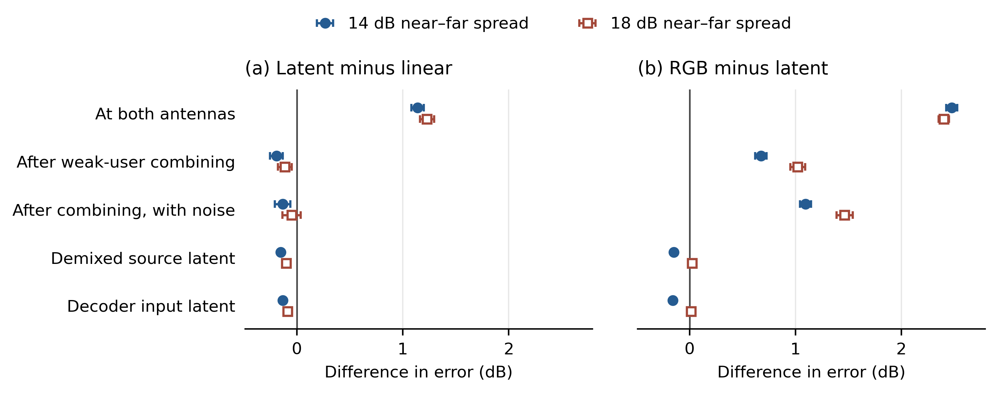
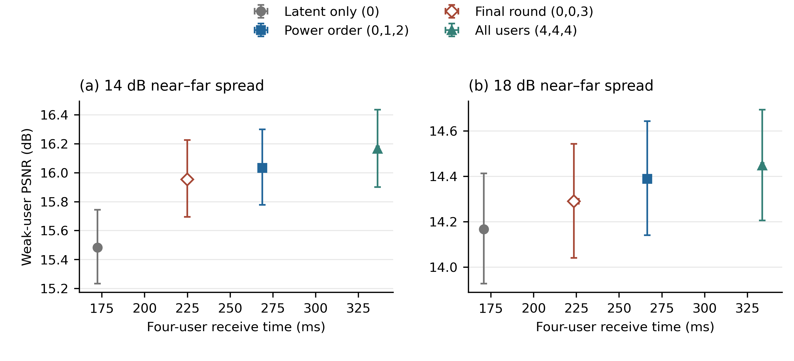

# 四用户过载上行中的干扰抵消与有限接收计算

同一对接收天线同时观测四个用户各自发送的不同图像。接收机迭代三轮，重建各用户的干扰波形，再分离剩余用户。本次比较沿用三个冻结检查点。先在相同接收波形上检查弱用户的分离过程，再测一次接收最多承担三次 RGB 解码及重编码时的质量与端到端接收时延。

## 干扰误差在哪一步改变排序

线性副本直接取解混潜变量。潜变量副本先经过已训练的潜变量去噪器。RGB 副本把去噪后的估计先解成图像，再经共享编码器和共享发端适配器生成潜变量以重调制。不同用户使用各自的 Walsh 签名。机制对照逐元素重用原潜变量接收机的十二个抵消权重，并逐轮验证弱用户的实际 LMMSE 合并矩阵完全一致。

下表给出第三轮的来源组配对差。每项测量都以左列指定的系统作差。前五行使用误差 dB，负值较好。PSNR 正值较好，DISTS 负值较好。括号为逐项 95% 区间。

| 观测量 | 潜变量减线性，14 dB | 潜变量减线性，18 dB | RGB 减潜变量，14 dB | RGB 减潜变量，18 dB |
|---|---:|---:|---:|---:|
| 双天线干扰误差 | +1.139 [+1.081, +1.199] | +1.227 [+1.162, +1.297] | +2.475 [+2.423, +2.527] | +2.401 [+2.351, +2.450] |
| 经弱用户合并器的干扰误差 | -0.193 [-0.253, -0.135] | -0.114 [-0.179, -0.048] | +0.675 [+0.622, +0.727] | +1.020 [+0.951, +1.093] |
| 经合并器的干扰加噪声误差 | -0.134 [-0.208, -0.062] | -0.049 [-0.136, +0.037] | +1.095 [+1.043, +1.147] | +1.463 [+1.387, +1.543] |
| 解混潜变量误差 | -0.155 [-0.171, -0.138] | -0.102 [-0.120, -0.084] | -0.147 [-0.168, -0.125] | +0.023 [-0.006, +0.054] |
| 图像解码器输入潜变量误差 | -0.134 [-0.149, -0.120] | -0.087 [-0.104, -0.070] | -0.158 [-0.179, -0.136] | +0.016 [-0.013, +0.047] |
| 弱用户图像 PSNR，dB | +2.464 [+2.236, +2.699] | +2.063 [+1.838, +2.292] | +0.704 [+0.584, +0.824] | +0.398 [+0.295, +0.504] |
| 弱用户图像 DISTS | -0.018 [-0.021, -0.015] | -0.019 [-0.022, -0.017] | -0.005 [-0.008, -0.001] | +0.008 [+0.005, +0.011] |

线性副本在两根天线上的总干扰误差较低。弱用户合并器对不同空间方向赋予不同权重，经过已实际使用的同一个合并器，潜变量副本在两个近远差下都把误差降得更低。比较只改变副本，能把这个排序反转定位在接收合并这一步。18 dB 下再计入噪声后，该项差异的区间跨零。

RGB 与潜变量的取舍发生在更后面。14 dB 下，RGB 的合并后干扰误差较高，源潜变量误差和图像失真却改善。18 dB 下，两项潜变量误差差值的区间均跨零，RGB 仍提高 PSNR，同时 DISTS 变差。逐图像素误差与感知失真给出了不同的判断。这些结果不足以把所有收益归因于某一种未测的语义特征。

测量中的分母随对象而定。天线误差用真实数据子空间中的干扰能量归一化，合并后误差用同一合并后的真实干扰能量。加入噪声的一行以合并后的期望用户信号能量为分母。后两项分别比较发送源潜变量以及在相同收端元数据下通过前端的干净潜变量。真信道、发端潜变量、发端图像只进入离线评分。旧研究中三种副本逐组的 PSNR、DISTS 均完全复现，干扰 NMSE 最大绝对差小于 0.000002 dB。

## 三次 RGB 调用怎样分配

一次调用指对一个用户做一次本地 RGB 解码及重编码。每次接收仍要输出四幅最终图像。全 RGB 接收对四个用户各做三次，共十二次。有限策略每帧最多三次。接收机依据估计信道功率识别最弱用户和干扰者，部署时看不到真实功率顺序。每个策略在实际抵消轨迹上计算自己的权重。

开发集包含 256 张图像，即 64 组，每组在两种近远差下各测一次。十五个候选由三套轮次分配与五条用户选择规则组成。按开发集弱用户平均 PSNR，固定排序选择分配 (0,1,2)，各轮按估计接收功率选最强干扰者。自适应排序选择 (0,0,3)，最后一轮把其余三个用户全部选中。在四用户均被检测为活跃时，末轮全选使该规则的排序分数没有实际选择作用。

正式测试包含 500 张图像构成的 125 个无交叠四图组，三个冻结检查点和两种近远差。除旧功率顺序的复现外，还实测了新信道和噪声下轮换发射功率所属用户的情形，避免最弱身份固定为第四槽。下表为轮换测试。先在四图组内平均检查点，再对四图组配对。两种布局共享图像，分别报告。

| 接收策略 | RGB 调用/帧 | 14 dB 弱用户 PSNR | 18 dB 弱用户 PSNR | 14 dB 弱用户 DISTS | 18 dB 弱用户 DISTS | 14 dB 接收时间，ms | 18 dB 接收时间，ms |
|---|---:|---:|---:|---:|---:|---:|---:|
| 仅潜变量 | 0.00 | 15.48 | 14.17 | 0.4085 | 0.4501 | 172.4 [171.8, 173.1] | 170.8 [170.2, 171.7] |
| 固定功率排序 (0,1,2) | 3.00 | 16.03 | 14.39 | 0.4065 | 0.4587 | 268.7 [268.1, 269.5] | 266.5 [265.7, 267.5] |
| 末轮全选，固定排序 | 3.00 | 15.95 | 14.29 | 0.4085 | 0.4642 | 224.7 [224.0, 225.6] | 221.9 [221.3, 222.6] |
| 末轮全选，按合并器泄漏排序 | 3.00 | 15.95 | 14.29 | 0.4085 | 0.4642 | 224.9 [224.2, 225.7] | 223.5 [221.9, 226.3] |
| 全 RGB | 12.00 | 16.17 | 14.45 | 0.4019 | 0.4611 | 336.2 [335.5, 337.0] | 333.7 [333.0, 334.5] |

横向区间按计时的 32 个四图组计算，纵向区间按质量评估的 125 个四图组计算。括号内给出每轮本地 RGB 调用次数。纵轴展示轮换功率、重新抽取信道和噪声后的弱用户质量。显著性以逐组直接作差的区间判断。

| 预先指定的配对比较 | 14 dB | 18 dB |
|---|---:|---:|
| 末轮全选减最强固定策略，弱用户 PSNR，dB | -0.080 [-0.149, -0.013] | -0.099 [-0.160, -0.037] |
| 末轮全选减同轮次固定策略，弱用户 PSNR，dB | +0.000 [+0.000, +0.000] | +0.000 [+0.000, +0.000] |
| 固定三次减仅潜变量，弱用户 PSNR，dB | +0.550 [+0.482, +0.622] | +0.222 [+0.151, +0.293] |
| 固定三次减仅潜变量，弱用户 DISTS | -0.002 [-0.004, -0.000] | +0.009 [+0.007, +0.011] |
| 全 RGB 减固定三次，弱用户 PSNR，dB | +0.132 [+0.057, +0.204] | +0.059 [-0.017, +0.134] |

固定三次相对仅潜变量的四用户平均 PSNR 差为 +0.583 [+0.550, +0.616] 和 +0.479 [+0.446, +0.512] dB。单独计算其余三个用户的等权平均，差值为 +0.594 [+0.556, +0.631] 和 +0.565 [+0.528, +0.603] dB。此项按每个四图组的原始分数推得，未参与策略选择。

以仅潜变量为起点，固定三次调用实现了十二次 RGB 调用所带来弱用户 PSNR 增益的 80.7% [72.2%, 90.7%] 和 78.9% [59.4%, 107.7%]。其整帧平均接收时延比全 RGB 分别低 20.1% 和 20.2%。末轮同时处理三个干扰用户可在一个批次内完成，(0,1,2) 分配要分两轮处理。两者承担相同的三次图像重编码，实测整帧时延仍有差别。

## 真正更换干扰用户的独立对照

开发集冻结结果揭示末轮全选的退化情形后，我们登记了单独的次要对照。登记时正式流程已写出一个条件文件，选择只读取开发集候选表。剔除选项顺序无法改变所选用户集的轮次分配后，开发集得分最高的自适应策略选择 (0,1,2)，按对当前最弱用户合并器的估计泄漏强度排序。对照使用完全相同的轮次分配，按估计接收功率排序。单独评估这一个新策略，固定对照质量复用同源同配置的 750 条正式记录。两者时延在新的同场会话中交错重测。

| 轮换布局，泄漏排序减功率排序 | 14 dB | 18 dB |
|---|---:|---:|
| 实际选人不同的碰撞比例 | 0.915 [0.885, 0.941] | 0.973 [0.957, 0.987] |
| 弱用户 PSNR，dB | -0.099 [-0.164, -0.036] | +0.012 [-0.056, +0.081] |
| 弱用户 DISTS | +0.002 [+0.001, +0.003] | +0.002 [+0.001, +0.004] |
| 四用户平均 PSNR，dB | -0.192 [-0.225, -0.160] | -0.114 [-0.148, -0.080] |
| 接收时延比，泄漏排序 / 功率排序 | 0.997 [0.987, 1.005] | 1.002 [0.999, 1.005] |

这项比较未在两个功率跨度上同时获得弱用户 PSNR 的正向配对区间。合并器输出能解释副本质量的排序反转，并不意味着干扰泄漏大就值得优先做昂贵的图像重建。选择动作还取决于 RGB 相对潜变量能修正多少误差。

## 计时、证据范围与长文定位

端到端接收时间从已在 GPU 上的四用户混合波形开始，结束于四个用户的 GPU RGB 输出。单碰撞批量，计时前后同步，含选人、三轮抵消、LMMSE 重解与最终图像解码。每种近远差使用前 32 个四图组、固定同一个检查点，每组两次交错测量。区间以四图组为单位。A800 为共享机器，给出实测范围。开发筛选使用同型号的另一块 A800，质量复核、正式测试、主要及次要计时均使用 GPU 3。

主比较预设条件同时要求轮换布局下的弱用户 PSNR 配对区间下端高于零，且自适应 / 最强固定的接收时间比上端不超过 1.05。14 dB 与 18 dB 的联合判据依次为 未达到、未达到。

长文可将干扰副本的评价目标从天线端 NMSE 推进到弱用户合并后的误差，再展示图像质量与计算开销。每帧三次的简单功率排序是实际可用的中间计算点。文中应同时给出全 RGB、仅潜变量和固定功率排序，以便读者选择。四用户均活跃、两个接收天线、两种功率跨度和这套冻结编码器构成直接证据的范围。稀疏活跃用户检测、真实射频测量与其他调制器需各自的数据。

Xie 等已在双用户 MIMO 上行中把强用户重建图像重新编码，用于弱用户的串行干扰抵消。本研究在四用户双天线的并行接收机内给出副本误差在哪个环节反转的直接测量，以及接收计算受限时不同选择规则的配对比较。本地 RGB 副本采用本系统的共享模型。 [Xie 等，式 (2)](https://arxiv.org/html/2504.07969v1#S2.SS2)

完整的逐组质量、各轮误差、时延原始值和区间见 [数值汇总](analysis/)。开发集全部 15 个候选见 [筛选表](development/candidates.csv)。[复现说明](../../experiments/replica-routing-20261127/REPRODUCE.md) 包含源数据和运行入口。
