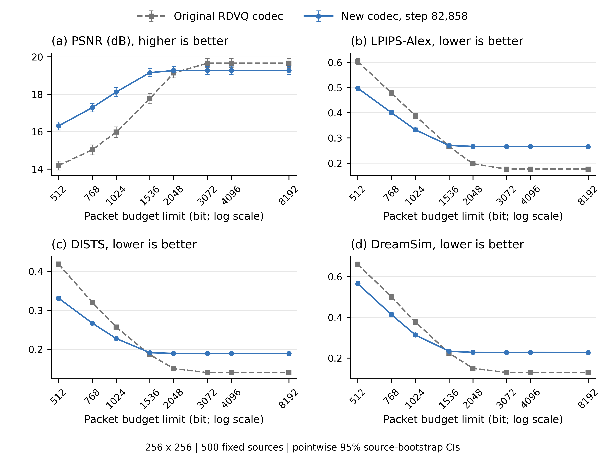

# 256 测试结果：低预算改善，高预算平台下降

2026-11-06。此次只完成提前停止检查点的 256×256 实际源包测试；不是原定完整训练计划的完成声明。

## 结论

新模型在 **512、768、1024 bit 的预算上限下，PSNR、LPIPS-Alex、DISTS、DreamSim 四项指标全部优于原始 RDVQ codec，直接来源配对 95% 区间均不跨零**。
到了高预算，情况相反：3072、4096、8192 bit 下四项指标都退步，配对区间均不跨零。整条率—质量曲线没有整体改善。

这轮实现了低预算重建能力的提升，但**没有实现提高完整表示重建平台的主要目标**。保持主训练与旧四臂暂停，本次不启动新训练、参数扫描或额外分辨率评测。

图中每点为相同 500 张源图的等权均值；误差棒为已完成的 10,000 次来源 bootstrap 逐点 95% 区间。横轴是允许的实际源包长度上限，采用 log2 数值坐标，并非平均实际码率。原始数据为 `summary.csv`，全部 64 个均值与 64 组区间均绘出。

## 完整配对结果

以下全部为 **新模型减原始 codec**，同一 500 源、同一预算上限直接配对。PSNR 正值有利于新模型；后三项负值有利。不能相减两组边际区间来代替这些配对区间。

| 包预算上限 (bit) | ΔPSNR (dB) ↑ | ΔLPIPS-Alex ↓ | ΔDISTS ↓ | ΔDreamSim ↓ |
|---:|---:|---:|---:|---:|
| 512 | +2.119081 [+2.018027, +2.218280] | -0.106018 [-0.112292, -0.099680] | -0.087555 [-0.092251, -0.082664] | -0.096092 [-0.105314, -0.086707] |
| 768 | +2.259899 [+2.164916, +2.355921] | -0.077829 [-0.083427, -0.072107] | -0.053637 [-0.057475, -0.049777] | -0.086712 [-0.095325, -0.078126] |
| 1024 | +2.144185 [+2.042107, +2.244096] | -0.055645 [-0.060602, -0.050618] | -0.029545 [-0.032611, -0.026448] | -0.063695 [-0.071371, -0.056027] |
| 1536 | +1.389806 [+1.274141, +1.500284] | +0.004002 [-0.000434, +0.008422] | +0.004995 [+0.002471, +0.007532] | +0.008877 [+0.002517, +0.015253] |
| 2048 | +0.129893 [+0.035633, +0.215436] | +0.068921 [+0.066286, +0.071585] | +0.038726 [+0.037116, +0.040364] | +0.078624 [+0.074794, +0.082541] |
| 3072 | -0.389527 [-0.469617, -0.316841] | +0.089150 [+0.086362, +0.092006] | +0.048707 [+0.047137, +0.050279] | +0.098866 [+0.094922, +0.102835] |
| 4096 | -0.383567 [-0.463844, -0.310759] | +0.089803 [+0.086982, +0.092662] | +0.049567 [+0.047985, +0.051162] | +0.099622 [+0.095667, +0.103587] |
| 8192 | -0.388869 [-0.469231, -0.315573] | +0.089195 [+0.086390, +0.092036] | +0.049017 [+0.047457, +0.050589] | +0.098962 [+0.095085, +0.102849] |

- **512–1024 bit：**四指标一致改善。1024 bit 的 PSNR 为 15.973→18.117 dB，DISTS 为 0.2570→0.2275，DreamSim 为 0.3773→0.3136。
- **1536 bit：**PSNR 改善 1.390 dB；LPIPS 区间跨零；DISTS、DreamSim 均退步，属于明确的质量取舍。
- **2048 bit：**PSNR 仍有较小改善 0.130 dB，三个感知指标均退步。
- **3072 bit 及以上：**新模型 PSNR 约 19.27 dB，低于原 codec 的 19.66 dB；LPIPS、DISTS、DreamSim 也全部更差。

## 实际包长与重建平台

| 预算上限 (bit) | 原 codec 平均实际包长 | 新 codec 平均实际包长 | 原 codec 完整表示 /500 | 新 codec 完整表示 /500 |
|---:|---:|---:|---:|---:|
| 512 | 462.576 | 472.960 | 0 | 0 |
| 768 | 705.712 | 737.920 | 3 | 3 |
| 1024 | 967.056 | 989.888 | 6 | 22 |
| 1536 | 1462.320 | 1354.000 | 46 | 440 |
| 2048 | 1877.824 | 1387.104 | 219 | 500 |
| 3072 | 2066.416 | 1390.640 | 500 | 500 |
| 4096 | 2066.416 | 1390.384 | 500 | 500 |
| 8192 | 2066.416 | 1390.864 | 500 | 500 |

新模型在 2048 bit 上限时，500/500 张已实际发送并独立恢复全部 1360 个 token；平均实际包长为 1387.104 bit。之后完整表示的平均包长约 1391 bit，额外预算基本没有转化为更高重建质量。原 codec 的完整表示为 336 个 token，3072 bit 时 500/500 张全部发送，平均包长 2066.416 bit。

新旧表示、量化和 token 数量不同，不能从 1360 对 336 推断信息量增加了四倍。新模型还按预算条件编码，高预算各点的原生输出并不严格相同；这里描述的是接近的平台，而不是声称各点像素完全相同。

本轮更符合“较少实际比特即可传完，但完整重建质量受损”的观测。将其解释为模型偏向压缩而牺牲细节是一个可能解释，**尚不是损失权重、量化器、架构或训练时长的单独因果结论**。已有训练记录中完整表示的 MSE、LPIPS-VGG 变差，与最终高预算结果方向一致，但训练损失不能替代本次测试结果。

## 测试与复用身份

- 检查点：`early_stop_step082858.pt`；SHA256 `30dd3c1f1796da8331762008786ae1a6dfa0cf75e5cf41e29bb143fcd23b7a09`。
- 639,592,611 个可训练参数；在 82,858 步提前安全停止。原计划 150,000 步及 512 分辨率训练未完成。该检查点按训练日志与用户期限停止，未在本次测试结果上搜索检查点。
- 固定 500 个留出源，八个预算上限；预处理、原生源像素、源顺序、原缓存身份及 bootstrap bank 已核验。
- 新模型：4000 次实际源编码、4000 次独立接收与重建、4000 对四指标评分；收到的前缀逐条匹配，所有原生输出有限。
- 原 codec：4000 个逻辑位置精确复用既有原生重建与指标；每分片固定一对、合计 8 对指标路线核验通过。没有重跑原 codec 编码与接收。
- 共 8000 个逻辑位置、64 个均值区间、32 个直接来源配对区间；没有 NULL、超预算或删减分母。
- 图和文字使用上述已完成结果；本轮复核没有新增模型调用，也没有重新计算 bootstrap。
- 新模型包封装 17 byte，原 codec 封装 9 byte，各自开销均计入上限。这是相同源包预算上限下的系统比较，不是相同实际包长或相同封装的控制实验；没有新增无线 PHY。
- 原生输出保存在 PFS。CSV 中的 `reference_sha256`、`reconstruction_sha256` 与 `origin` 保留来源；不以 PNG 替代指标输入。

## 实际资源与停止状态

256 测试的 24 个 GPU 工作角色与 1 个 CPU 统计角色均实际 exit 0，控制器及全部子进程已退出。控制器墙钟 28.94 分钟，GPU 1.812041 设备小时，叶子进程 CPU 1.896606 小时。CPU 只累计 25 个叶子回执，不再加入包含子进程的控制器 CPU 时间。

此前主训练四个连续阶段实际合计 120.042112 GPU 设备小时。测试前旧入口的 step150000 检查在模型推理前失败；其两次模型构造、零源编码/接收/评分记录及独立 v2 入场修订仍保留在 `../earlystop_256_v2/`，没有覆盖失败或重跑成功调用。测试资源与训练资源分开报告。

主训练 `STOP_MAIN` 和旧 P2 `STOP_P2` 均保留；旧四臂继续暂停。COCO 实际训练语料为 116238 张，OpenImages 未进入这次训练。512 测试未执行。当前结果不能推出提前停止步数最优，也不能推断更早检查点或另一训练目标一定更好。

## 可复核交付

- `frame_metrics.csv`：8000 行，原生输出身份与四指标。
- `summary.csv`、`paired_deltas.csv`、`capacity.csv`：完整正负结果与容量。
- `protocol.json`、`source_manifest.json`、`statistics_identity.json`：冻结范围、源映射与 10000×500 bank 身份。
- `completion_snapshot.json`：25 个角色登记、PID/start_ticks、实际退出回执、独立接收核验与缓存路线核验。
- `actual_compute_and_reuse.json`、`resource_ledger_final.json`：实际调用/复用及不重复累计的最终测试资源账本；原 `resource_ledger.json` 保留生成时快照。
- `data_audit.json`、`audit_delivery.py`：分母、源身份、包预算、均值/配对点估计与回执复核。区间由原统计阶段产生，本脚本不重新抽样。
- `draw_quality.py`、`figure_identity.json`、`quality_vs_budget.pdf/svg/png`：完整四指标图、来源 hash 与物理尺寸。

重绘命令：`python draw_quality.py`；CSV 及上述脚本放在同一目录。图尺寸 182.88×139.70 mm，PNG 600 dpi，矢量 PDF/SVG 同源导出。
