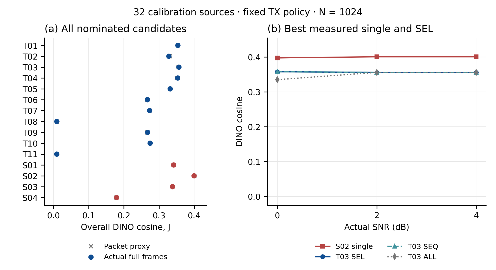
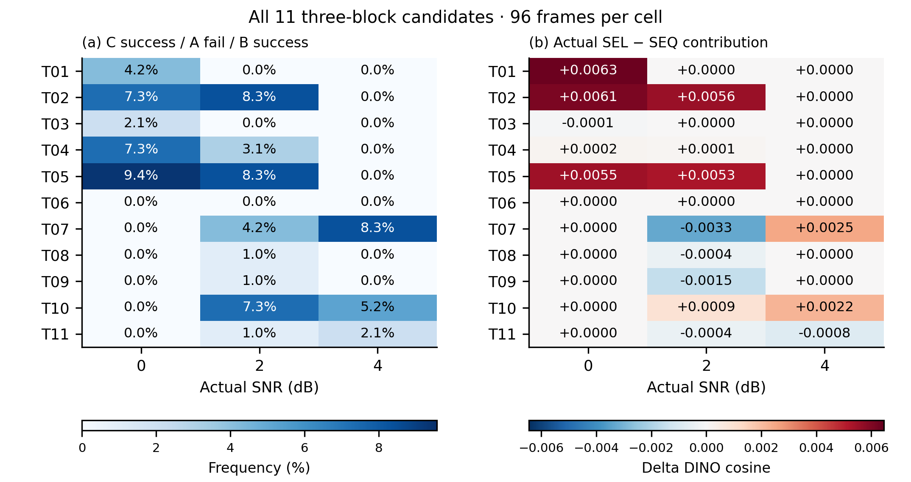

# 同尺度分块保护与选择性恢复：P0–P3 完整交付

结论：**NO_GO_STOP**。源码独立恢复和 C+B 干净状态价值成立；在本次预定候选、固定 TX 策略与 0/2/4 dB 等权分布下，尚未补偿分包与短码块成本。P4/P5 不启动；原 WCL 与旧负结果保持不变。

## 先回答六个问题

1. **删除 A 后，B 能否独立恢复？能。** 128/128 删除 A 的实收源码恢复逐 token 精确一致；128/128 完整往返通过；删除 C 时不调用先验恢复 B。128 个全 CAB 原生图像与等价连续前缀逐像素相同。
2. **C+B 是否有质量价值？有平均价值，但不保证逐图改善。** 四个预定配置的平均 DINO(C+B)−DINO(C) 为 +0.053907、+0.030066、+0.035832、+0.061830；所有逐源负值与其他四指标保留。
3. **真实信道中是否出现 C+B？出现 77/3168 个三块物理帧（2.4306%）。** 这是 11 个候选各 288 帧的描述性合计，不能当作一个部署策略的发生率。逐候选/逐 SNR 见 state_counts.csv。
4. **SEL−SEQ 的贡献多大？依候选而定，存在正值、零值和负值。** 本轮最佳 SEL 候选的总体 ΔJ_SEL−SEQ = -0.000023602340；下面报告全部候选。逐源、逐噪声用同一波形回放，频率×实际 C+B−C 的分解恒等式逐项通过。
5. **是否胜过重新校准单块？没有。** 最佳已测 SEL J=0.356429421213559，最佳已测单块 J=0.399495571411939，差 -0.043066150198380。单块最优只指四个实际提名候选，不声称全部 100 候选均完成无线最优化。
6. **是否进入 P4？不建议自动推进。** 没有候选同时满足 J_SEL>最佳已测单块 且 J_SEL>自身 SEQ。按原门槛停止，不扩大尺度/位置/码率/信道/功率，不训练。

## 固定范围与统计口径

- 内容无关选取 cal1000 内 32 源，保留 source_id/source_index；不是 common500 正式测试，也不是独立盲测。
- TX 名义 2 dB，同一候选跨实际 0/2/4 dB；每源每点三次噪声。先平均每源三次噪声，再等权源图，最后等权三个 SNR。J 始终为 DINOv2-L cosine；PSNR↑、LPIPS-Alex↓、DreamSim↓、CLIP-I↑同步完整报告。
- 本轮没有新增 bootstrap/CI/显著性检验。全部差值是来源配对描述量；候选间使用各自登记噪声，ALL/SEQ/SEL 则严格共用同一完整接收记录。
- N=1024=68+956，Es=2，总能量2048。头部为实际 ±(1+j) 两点映射；正文 QPSK。每块 L13+padding+CRC16，独立算术 finish 和 LDPC。
- 120 三块+100 单块全部参加代理筛选。按固定分层规则选出 11 三块+4 单块，tie 采用 candidate_id 升序。代理独立包假设只用于提名，不作为完整无线结果。

## 所有实际提名候选

|候选 ID|J proxy|J 实测 SEL/单块|ΔJ SEL−SEQ|C+B 帧数 / 288|
|---|---:|---:|---:|---:|
|T_m4_K12_N598_r1-3_1-3|0.355005021|0.353516597|+0.002108382|4|
|T_m4_K12_N718_r1-3_1-2|0.330899951|0.327936018|+0.003874211|15|
|T_m4_K25_N598_r1-3_1-3|0.355005021|0.356429421|-0.000023602|2|
|T_m4_K25_N598_r1-3_1-2|0.350703982|0.352977625|+0.000108912|10|
|T_m4_K25_N718_r1-3_1-2|0.330899951|0.331566454|+0.003579730|17|
|T_m5_K18_N718_r1-2_1-2|0.266063426|0.267034229|+0.000000000|0|
|T_m5_K18_N718_r1-2_2-3|0.275326505|0.273322445|-0.000270946|12|
|T_m5_K18_N718_r1-3_2-3|0.009963997|0.009684778|-0.000134811|1|
|T_m5_K36_N718_r1-2_1-2|0.266063426|0.267744564|-0.000504163|1|
|T_m5_K36_N718_r1-2_2-3|0.275326505|0.274585161|+0.001038400|12|
|T_m5_K36_N718_r1-3_2-3|0.009963997|0.009516578|-0.000404433|3|
|S_m5_K18_r1-4|0.341305554|0.341305554|—|—|
|S_m5_K27_r1-3|0.400565013|0.399495571|—|—|
|S_m6_K16_r1-2|0.338367538|0.338367538|—|—|
|S_m6_K48_r2-3|0.178192681|0.179734229|—|—|

目标端点不同的候选可能按实际码长退到同一配置，但固定事件身份和噪声不同，仍各报告其 288 帧。不能将这些小差异解读为目标端点本身的收益。

## 最佳已测单块与最佳 SEL 的五指标

|指标|最佳单块|最佳 SEL|SEL−单块|
|---|---:|---:|---:|
|dino_cosine|0.399495571|0.356429421|-0.043066150|
|psnr_db|16.152530609|15.660982881|-0.491547728|
|lpips_alex|0.342533655|0.382748901|+0.040215246|
|dreamsim|0.275856702|0.323119454|+0.047262752|
|clip_image_cosine|0.766555947|0.731608204|-0.034947743|

单块：`S_m5_K27_r1-3`；三块：`T_m4_K25_N598_r1-3_1-3`。两者均按原 J 选择，未按报告指标换目标。

## 失败、成本与实际计算

- P2：28 个新几何各一次无噪声往返通过，另4个头部工程例；10,752有噪正文包+384头部，全部原记录保留。
- P3：4,320完整物理帧 / 10,656实际发送正文块 / 4,320实际头部译码 / 9,029实际正文译码尝试。其余正文仍发送并计费，因接收头部失败或合法 NULL 而不译码。
- 每候选/SNR完整分母96，每候选总288。三块 ALL/SEQ/SEL 产生9,504逻辑回放，加单块1,152，共10,656指标记录；这些不是新增物理帧。
- 3次头部拒收、540个合法付费NULL、673次非NULL粗块/单块CRC拒收；无通过校验却内容错误的头部或正文。全部计入质量分母。A/B 的CRC拒收、条件不可用、付费空块逐帧分开保存。
- 原完整四配置源开销：固定字段比单块多58bit；实测独立AC额外0–4bit；合计58–62bit，平均60.21875bit。真实回退后的逐帧码长、字段与利用率另见 p3_frame_accounting.csv，NULL从未静默省能量。
- P1 已完成32概率遍历、0 tokenizer；正常状态928，包含247旧原生接收复用、553新连续状态、128新C+B；另128次全CAB对齐验证。新decoder总809次，正常状态与技术验证分开记账。
- P3 独立接收缓存按实际收到的码流与粗尺度依赖精确复用 5964 次，覆盖384种实际解码输入身份；复用286张原生图和318个源图—重建评分对（含32灰图对）。P3新增VAR/decoder/指标推理均0，未把TX真值补给RX。
- 实测科学/控制/审计资源累计：GPU 0.360739设备小时，CPU 0.157115worker小时，均低于各32小时固定上限。详细逐阶段等待记录见 resource_accounting_final.json（链接原 resource_accounting.json）；仓库工程检查单列，不是科学试验。

## 实现修订与验收

首次P3 CPU缓存准备错误地假定 source pixel hash 是统一预处理流程ID，执行在任何P3接收回放前退出1。原脚本/失败/哈希保留；独立v2修订依据实际接收内容查缓存，原full-key不改，碰撞要求像素相同。详见 CACHE_IDENTITY_CORRECTION.md 和最小差异。未重跑任何成功科学调用。
验收通过：540个完整观测批次/4320帧和9029正文hard数组哈希一致；53,280个指标数值与既有精确评分对一致；286原生重建、32原图哈希实际核验；37个候选×模式总体均值与逐帧重算一致。P1全CAB像素一致与删除A/C源码证明保持有效。

## 文件与复现

- `nomination.json`、`p2_proxy_all_candidates.csv`：220候选和全部固定提名原因；`p2_actual_length_fallback.csv`保留逐源回退。
- `p3_physical_events.csv`：真实帧、接收状态、回退与错误审计；观测大数组留在登记PFS路径。
- `replay_metrics.csv`、`p3_source_means.csv`：全部回放与来源聚合；`p3_candidate_snr_summary.csv`和`p3_candidate_overall.csv`为五指标完整结果。
- `paired_source_differences.csv`、`paired_mean_differences.csv`：SEL−SEQ及SEL−最佳已测单块的直接来源配对差。
- `state_counts.csv`、`selective_mechanism_contribution.csv`：完整分母、机制频率×实际质量贡献。
- `codec_proof.json`、`phy_layouts.csv`、`p3_final_audit.json`、`p3_closed_receipts/`：资格与真实闭合证据。
- `figures_v2/`：两个结果图的PDF/SVG/PNG、输入哈希和候选标签映射；`experiments/nextscale-selective-blocks-20261028/plot_p3_v2.py`可复现。
- 历史P1报告、原scope/协议/登记保持原字节。权重、原图、token/数组、环境与大日志不进入Git。

本轮所有 P0–P3 科学步骤已完成，无待运行科学项；P4/P5按授权边界和实际NO_GO停止。最终图表已实际打开检查，见 p3_visual_review.json；仓库检查见 validation_p3/CHECKS.json，最终提交和远端 SHA 在交付回执中记录。
