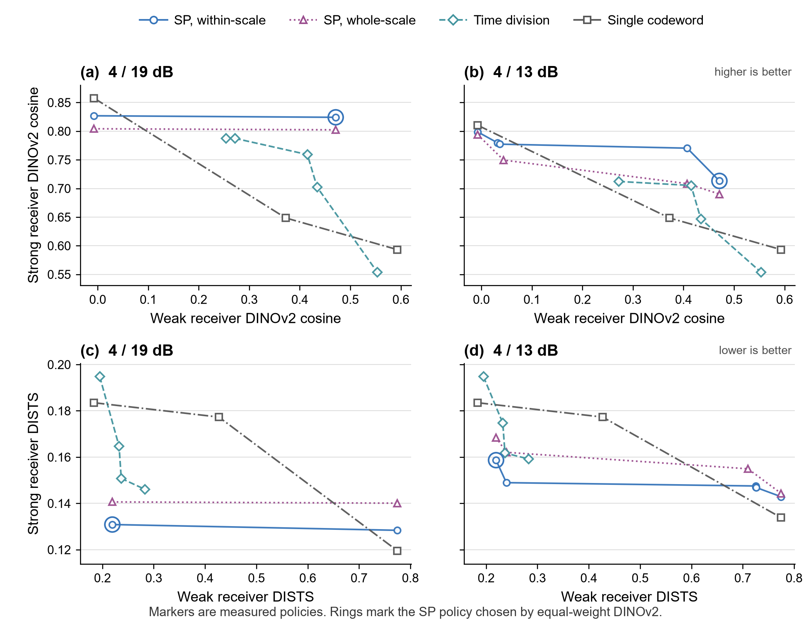

# Superposition NeST-Com 的 Pilot50 广播结果

**SP0 通过。SP1 在 4/19 dB 和 4/13 dB 两组信道均未达到预登记门槛，结论为 NO-GO。** 与时分正交传输（OMA）相比，满码长叠加在两组信道的等权 DINOv2 和 DISTS 上均有改善。与最优单码字相比，4/19 dB 的 DISTS 改善幅度有限，4/13 dB 的 DISTS 和 DreamSim 均变差。实验按规则止于 Pilot50，SP2 正式测试为 0 帧。[判决和全部门槛](a800_pilot_v1/decision.json) · [预登记协议](a800_pilot_v1/sp1_protocol.json)

## 两名接收端等权时的效果

差值均为叠加方案减去同一信道对、同一选择目标下的最优对照。DINOv2 越高越好，DISTS 和 DreamSim 越低越好。区间来自对同一批 50 个源图的 10,000 次配对重采样。每张图先平均三次噪声，再对两名接收端等权平均。

| 弱 / 强 SNR | 对照 | ΔDINOv2 [95% CI] | ΔDISTS [95% CI] | ΔDreamSim [95% CI] | ΔPSNR，dB [95% CI] |
|---|---|---:|---:|---:|---:|
| 4 / 19 dB | 单码字 | +0.0544 [0.0248, 0.0848] | −0.0084 [−0.0120, −0.0049] | −0.0048 [−0.0138, 0.0044] | +1.118 [0.854, 1.412] |
| 4 / 13 dB | 单码字 | −0.0011 [−0.0278, 0.0266] | +0.0055 [0.0019, 0.0091] | +0.0179 [0.0086, 0.0276] | +0.043 [−0.154, 0.248] |
| 4 / 19 dB | 时分 | +0.0605 [0.0384, 0.0824] | −0.0188 [−0.0221, −0.0156] | −0.0289 [−0.0359, −0.0226] | +1.157 [0.945, 1.389] |
| 4 / 13 dB | 时分 | +0.0320 [0.0120, 0.0533] | −0.0102 [−0.0141, −0.0066] | −0.0161 [−0.0233, −0.0091] | +0.494 [0.308, 0.688] |

相对单码字，预定条件要求两组信道的 DISTS 都至少下降 0.025、相对下降超过 12%，且 DreamSim 至少下降 0.035。两项配对区间还须支持改善。4/19 dB 的 DISTS 相对下降 4.58%，DreamSim 区间跨零。4/13 dB 的 DISTS 相对上升 3.00%。4/19 dB 的等权 DINOv2 超出全部单码字候选，4/13 dB 的等权 DINOv2 略低于最优单码字。所有差值对应在这 50 个源上选出的策略，区间以选定策略为条件。[全部配对差值](a800_pilot_v1/paired_differences.csv) · [五档权重的工作点](a800_pilot_v1/selected_operating_points.csv)

## 增益去了哪一端

| 弱 / 强 SNR | 方案 | 弱端 DISTS ↓ | 强端 DISTS ↓ | 两端等权 DISTS ↓ |
|---|---|---:|---:|---:|
| 4 / 19 dB | 单码字 | 0.18349 | 0.18349 | 0.18349 |
| 4 / 19 dB | 叠加 | 0.21932 | 0.13085 | 0.17509 |
| 4 / 13 dB | 单码字 | 0.18349 | 0.18349 | 0.18349 |
| 4 / 13 dB | 叠加 | 0.21932 | 0.15867 | 0.18900 |

两组等权最优叠加策略都将 85% 的正文功率分给 QPSK、码率 1/2 的基础层，基础层上限均为第 6 尺度。弱端在 150 次接收中全部只恢复基础层，强端在 150 次接收中全部恢复双层。两组最优单码字均选用 QPSK、码率 2/3 和上限 (7,0)，两端各 150 次全部成功。19 dB 强端选用 16-QAM、码率 3/4 的增强层，强端质量的改善足以抵消弱端损失。13 dB 强端选用 QPSK、码率 2/3 的增强层，其改善较小，两端平均 DISTS 随之上升。[两端指标和解码状态](a800_pilot_v1/selected_operating_points.csv)

固定所选叠加功率、两层 MCS、基础层上限和增强上限所在尺度，把增强层的整尺度端点细化为 Quarter 后，4/19 dB 的等权 PSNR 提高 0.337 dB [0.255, 0.426]，4/13 dB 提高 0.301 dB [0.204, 0.405]。两组 DISTS 分别下降 0.00489 和 0.00491。这个对照支持本次广播配置中尺度内端点的作用。与时分的系统级差值同时包含波形、两层码长和所选配置的影响。[配对结果](a800_pilot_v1/paired_differences.csv) · [逐源均值](a800_pilot_v1/selected_source_means.csv)

图中标记对应各族实测的非支配点，连线用于阅读。上排 DINOv2 以右上为优，下排 DISTS 以左下为优。蓝圈标出两名用户等权时按 DINOv2 选出的叠加策略。每个接收端的完整均值和全部策略均可核查。[矢量图](a800_pilot_v1/receiver_frontiers.pdf) · [前沿数据](a800_pilot_v1/observed_frontiers.csv) · [全部候选](a800_pilot_v1/all_policy_means.csv)

## 执行和复核

- **SP0。** 工程测试的 24 个无噪声双层帧全部独立解码，单层极限 LLR 的最大绝对误差为 2.523×10⁻¹⁰。在 A800 上对全部 50 张固定源图重建一致的 TX/RX 概率路径，得到了 200 个规范基础流、3,600 条双段码长和 32,550 个逐 token 单码字候选长度。四项评分覆盖 1,250 个主端点、526 个单码字额外回退端点及 50 个固定灰图，共 1,826 个源图与输出配对。历史 H800 的码流和重建保留作来源对照。[工程资格](sp0_radio.json) · [双段码长](a800_pilot_v1/double_stream_lengths.csv) · [全部干净评分](a800_pilot_v1/clean_scores.csv)
- **SP1。** 每次发送固定 1,024 个复符号，68 个用于公共保护头，956 个用于正文，标称符号能量为 2。独立接收端从带噪头部读取配置，只有通过校验的基础层才能驱动干扰消除。单码字沿用原方法/MCS 预配置目录，叠加和时分分别使用 3,805 项和 4,048 项公开目录，均含 NULL。三组的实际平均帧符号能量分别为单码字 2.00037、叠加 1.99902、时分 1.99956。[协议](a800_pilot_v1/sp1_protocol.json) · [能量和接收状态](a800_pilot_v1/actual_compute.json)
- **样本与去重。** 300 个单码字候选来自 12 个 MCS × 25 个真实 NeST 上限，原表余下的 96 项属于 WHOLE 或 Ada。叠加与时分各 3,420 个候选。按同源、相同实际发送配置与码流复用等价候选后，实测叠加 133,428 帧、单码字 30,402 帧和时分 26,991 帧，共 190,821 个发射波形、572,463 次接收。两组比较共享 4 dB 弱端，13 和 19 dB 强端缩放同一组标准噪声。全部灰图与退化状态计入分母，未决接收输入为零。[样本清单](a800_pilot_v1/source_manifest.json) · [候选身份](pfs_recovery_v1/single_catalog_decision.json) · [工作点与统计身份](a800_pilot_v1/sp1_plan_identity.json)
- **资源和阶段边界。** 冻结模型推理与实际 5G NR LDPC 物理层仿真使用同一张 NVIDIA A800 80 GB。五个使用 GPU 的科学阶段合计 0.361 设备小时，含阶段内 CPU 处理与 I/O。原四臂的暂停标记已核验。大型重建数组、波形和原始运行日志保存在 PFS。此分支交付代码、配置、均值、区间、图及轻量回执。[资源账本](a800_pilot_v1/resource_ledger.json) · [运行与退出记录](a800_pilot_v1/execution.json)
